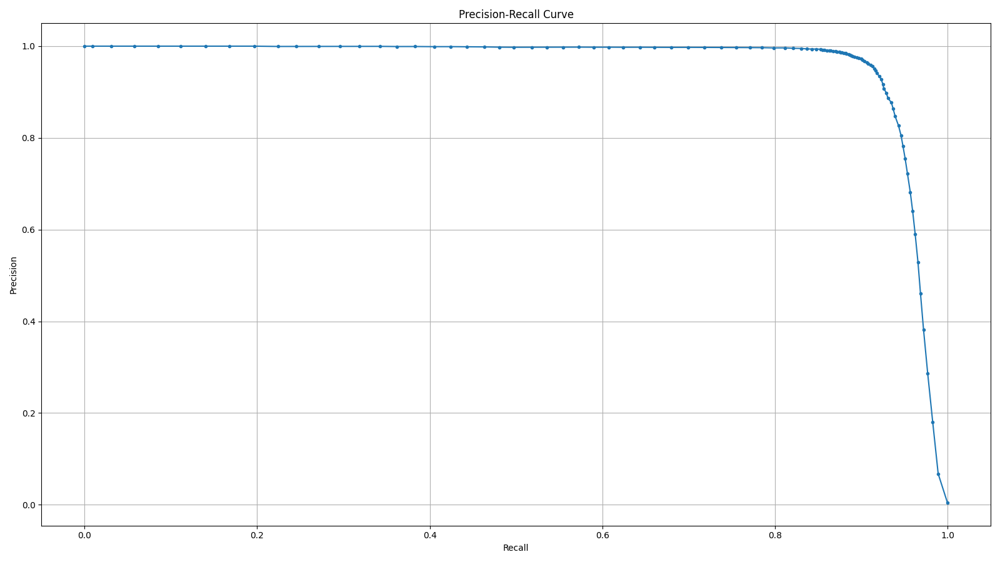

# SecureBank Fraud Detection

A containerized fraud detection service. It builds features from raw transaction, customer, and fraud label data, trains a random forest classifier, and serves predictions through a Flask API, with every request logged for auditing.

## Results

Evaluated on 1,482,872 transactions, of which 6,496 were fraudulent (about 0.44 percent).

| Class | Precision | Recall | F1 |
|---|---|---|---|
| Fraud | 0.991 | 0.863 | 0.922 |
| Legitimate | 0.999 | 1.000 | 1.000 |
| Macro average | 0.995 | 0.931 | 0.961 |

Only 53 legitimate transactions were flagged as fraud, while 891 fraudulent transactions were missed. The model favors precision, which keeps false alarms for customers low, and the [system report](securebank/System_Report.MD) discusses how a lower decision threshold would trade some of that precision for higher recall.

<p align="center">
  
</p>

## How it works

1. **Data handling.** `RawDataHandler` loads and merges the transaction, customer, and fraud label sources and summarizes data quality.
2. **Feature engineering.** `dataset_builder.py` adds the transaction hour and day of week, the time since the customer's previous transaction, the distance between customer and merchant, and a smoothed fraud rate for each merchant category, then saves a versioned dataset.
3. **Training.** `train_model.py` encodes categorical features according to their cardinality, trains a 100 tree random forest, and saves a versioned model and preprocessor.
4. **Evaluation.** `evaluate_results.py` writes precision, recall, F1, the confusion matrix, and ROC and precision recall curves to `storage/results/`.
5. **Serving.** `app.py` exposes `/predict/`, `/create_dataset`, and `/train_model`, and logs each request and response as timestamped JSON.

## Running it

The raw data sources were provided by the course and are not included. Place `customer_release.csv`, `fraud_release.json`, and `transactions_release.parquet` in `securebank/data_sources/`, then follow [securebank/README.md](securebank/README.md) to run the pipeline locally or in Docker.

```bash
pip install -r securebank/requirements.txt
python securebank/modules/data/dataset_builder.py
python securebank/modules/models/train_model.py
python securebank/modules/models/evaluate_results.py
```

## Built with

Python, scikit-learn, pandas, Flask, Docker

## Context

Built for EN.705.603 Creating AI-Enabled Systems at Johns Hopkins University (Summer 2025). Course datasets, starter code, and unit tests are not included.
