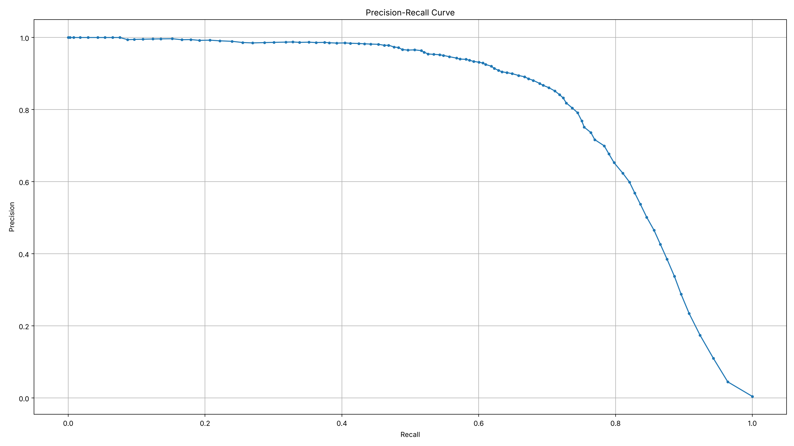

# SecureBank Fraud Detection

A containerized fraud detection service. It builds features from raw transaction, customer, and fraud label data, trains a random forest classifier, and serves predictions through a Flask API, with every request logged for auditing.

## Results

Evaluated on a held out test set of 444,862 transactions, 1,949 of them fraudulent, that the model never saw during training.

| Class | Precision | Recall | F1 |
|---|---|---|---|
| Fraud | 0.952 | 0.543 | 0.692 |
| Legitimate | 0.998 | 1.000 | 0.999 |
| Macro average | 0.975 | 0.771 | 0.845 |

ROC AUC is 0.978 and average precision is 0.809. Only 53 legitimate transactions were flagged as fraud, while 891 of the 1,949 fraudulent transactions were missed. The model is strongly precision oriented, which keeps false alarms for customers low but lets close to half of fraud through. The [system report](securebank/System_Report.MD) discusses how threshold tuning, class weighting, and hyperparameter search could raise recall.

<p align="center">
  
</p>

## How it works

1. **Data handling.** `RawDataHandler` loads and merges the transaction, customer, and fraud label sources and summarizes data quality.
2. **Feature engineering.** `dataset_builder.py` adds the transaction hour and day of week, the time since the customer's previous transaction, the distance between customer and merchant, and a smoothed fraud rate for each merchant category, then saves a versioned dataset.
3. **Training.** `train_model.py` encodes categorical features according to their cardinality, trains a 100 tree random forest, and saves a versioned model and preprocessor.
4. **Evaluation.** `evaluate_results.py` scores the model on the same held out 30 percent test split used in training and writes precision, recall, F1, the confusion matrix, and ROC and precision recall curves to `storage/results/`.
5. **Serving.** `app.py` exposes `/predict/`, `/create_dataset`, and `/train_model`, and logs each request and response as timestamped JSON.

## Running it

The raw data sources were provided by the course and are not included. Place `customer_release.csv`, `fraud_release.json`, and `transactions_release.parquet` in `securebank/data_sources/`, then follow [securebank/README.md](securebank/README.md) to run the pipeline locally or in Docker.

```bash
pip install -r securebank/requirements.txt
python securebank/modules/data/dataset_builder.py
python securebank/modules/models/train_model.py
python securebank/modules/models/evaluate_results.py
```

## Built with

Python, scikit-learn, pandas, Flask, Docker

## Context

Built for EN.705.603 Creating AI-Enabled Systems at Johns Hopkins University (Summer 2025). Course datasets, starter code, and unit tests are not included.
