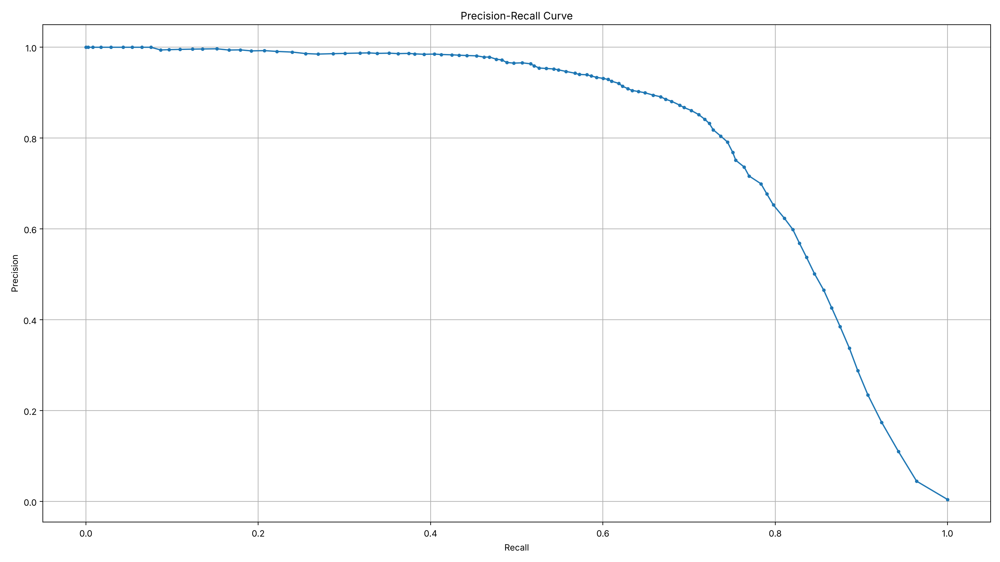
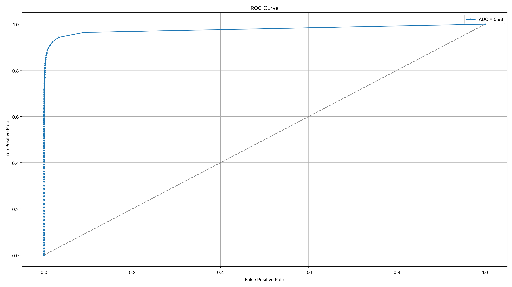
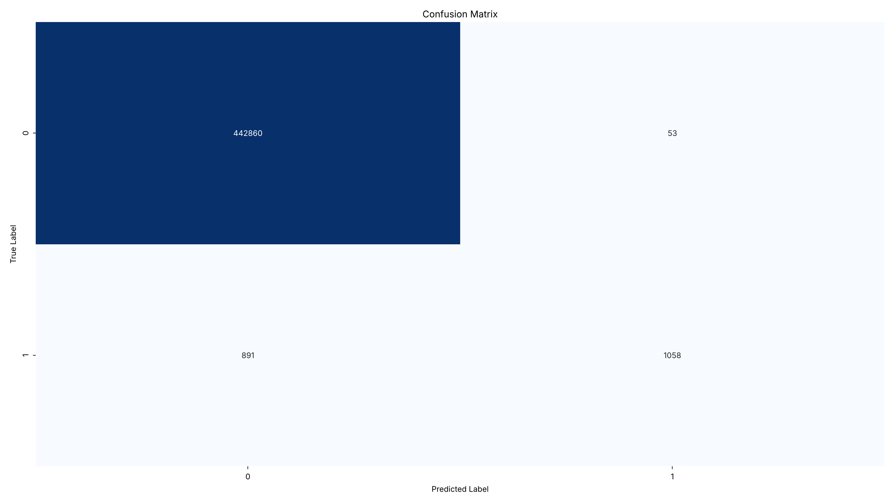

# System Report for the *SecureBank* System
# Adam Lane

## **Introduction**

This report provides a comprehensive overview of the *SecureBank* fraud detection system, detailing design decisions, data handling strategies, model development, performance evaluation, and deployment considerations. The system aims to accurately identify fraudulent transactions while minimizing disruptions to legitimate customer activity. By combining robust data preprocessing, carefully selected machine learning models, and ongoing monitoring, *SecureBank*’s solution strives to balance fraud mitigation with customer experience. This document outlines the thought process behind several key choices made for the system, evaluates system performance through rigorous testing, and describes deployment and post-deployment practices to ensure effectiveness in a real-world financial environment.

## **System Description**

The *SecureBank* fraud detection system has been designed to fulfill all the outlined minimum requirements, establishing a solid foundation for reliable fraud identification. The system begins by ingesting raw transaction data and performing essential preprocessing steps, such as handling missing values and extracting temporal features like month, day, and specific day of the week. These engineered features help the model capture seasonal and behavioral trends that improve its ability to distinguish fraudulent transactions. Additionally, the system carefully removes sensitive or irrelevant columns to maintain data privacy and align with operational needs.

At its core, the system trains a supervised machine learning model, specifically a Random Forest Classifier, using the processed dataset. Evaluation on a held out test set with standard metrics (including precision, recall, F1-score, confusion matrices, and ROC AUC) provides an offline performance assessment prior to deployment. The design also includes a Flask-based API for real-time fraud prediction, allowing seamless integration into *SecureBank*’s operational environment by accepting transaction details and returning fraud risk assessments instantly.

Beyond simply meeting requirements, the system offers several enhancements that improve robustness and usability. The modular architecture separates concerns among data processing, model training, evaluation, and prediction serving, enabling maintainability and future extensibility. Moreover, it produces detailed comprehensive reports and visualizations that provide rich insights for stakeholders to understand model behavior. Thoughtful error handling and logging in the API further support operational transparency and troubleshooting.

Looking forward, the system provides a flexible foundation to incorporate future improvements. More advanced modeling techniques, such as gradient boosting or deep learning, could boost detection accuracy, especially for subtle fraud cases. Implementing adaptive learning pipelines that detect and respond to concept drift would maintain model relevance as fraud patterns evolve. Enhancements in approximation and interpretability through tools like SHAP (SHapley Additive exPlanations) or LIME (Local Interpretable Model-agnostic Explanations) could build stakeholder trust and mitigate bias. On the deployment side, policies like step-up authentication for uncertain predictions could reduce false positives and negatives, balancing security and customer experience. Finally, containerization and orchestration strategies would prepare the system for scalable, high-availability production environments.

In summary, the current *SecureBank* system not only satisfies the baseline requirements with a structured and effective fraud detection pipeline, but also lays a stable groundwork for ongoing enhancements that address emerging challenges and operational demands.

## **Data Design**

The data design for the *SecureBank* fraud detection system focuses on selecting meaningful features, applying consistent preprocessing, and maintaining high dataset quality to support accurate and reliable modeling. Feature selection is driven by domain knowledge and exploratory analysis, emphasizing the variables that are most relevant to fraud patterns. Key features include transaction amounts, merchant categories, and temporal attributes such as transaction month, day, and day of week. These temporal features help capture periodic behaviors and seasonal trends which are often indicative of which transactions are legitimate versus fraudulent. Additionally, features related to merchant location and transaction context are included to enrich the model’s understanding of transactional risk.

Preprocessing techniques are carefully applied to prepare the raw data for modeling, and the pipeline handles missing values by dropping rows missing the target label to maintain label integrity. Non-predictive or sensitive identifiers, such as customer personal information and transaction ID's, are removed to protect privacy and prevent data leakage. Date-time fields are converted and decomposed into meaningful components (such as month, day, weekday) to enable temporal pattern recognition. All categorical variables are appropriately encoded and numerical features scaled as needed through a fitted preprocessing pipeline, ensuring consistent transformations between training and inference. This process reduces noise, standardizes input, and aligns features to the model’s expectations.

Data partitioning is performed using a temporal split strategy that respects the chronological order of transactions. This simulates a real-world scenario where models are trained on past data and evaluated on future unseen data, mitigating data leakage and providing a realistic assessment of model generalization. Afterwards, the dataset can then be divided into training and validation sets based on transaction timestamps. Doing so enables robust model tuning and performance estimation under conditions more accurately reflective of typical production deployment.

It should be noted that the *SecureBank* system utilizes three key datasets to support model development and evaluation. The train dataset is used to train the fraud detection model by allowing it to learn from labeled examples, forming the basis for parameter optimization and pattern discovery. The test dataset, which is held out from training, provides an unbiased assessment of the model’s performance on unseen data, and is used solely for final evaluation to estimate real-world effectiveness. The full dataset includes both the train and test samples and serves as the foundation for feature engineering. It can also be used to retrain models to leverage all available data once evaluation is complete. This partitioning strategy ensures robust model development and trustworthy evaluation while maximizing data utility.

We can ensure dataset quality through a series of safeguards. Rows with missing or invalid target labels are removed to avoid bias and inaccuracies, while extensive exploratory data analysis helps identify and resolve outliers, inconsistencies, and unusual patterns. Automated scripts check for consistency and completeness at every stage of preparation, while dataset logging and versioning record data origins for reproducibility and auditing. Together, these measures ensure the model is trained and evaluated on clean, representative, high quality data, maximizing the reliability of fraud detection results.

## **Model Design**

As mentioned previously, the *SecureBank* fraud detection system employs a Random Forest Classifier, which was selected for its robustness, interpretability, and ability to handle imbalanced datasets effectively. Random Forests are ensemble methods that combine multiple decision trees, reducing overfitting risks while capturing complex feature interactions essential for fraud detection. This helps to balance predictive power and operational efficiency while also enabling scalable training and fast inference. This is critical in real-time fraud monitoring environments.

The model is a random forest of 100 trees with scikit-learn's default settings. The labeled data is split into a 70 percent training set and a 30 percent test set, stratified so that the rare fraud class appears in the same proportion in both. No hyperparameter search or class weighting is applied in this version. Tuning the number of trees, the maximum depth, and the minimum samples per leaf with a cross validated grid search, and weighting the fraud class more heavily, are the most direct next steps for raising fraud recall.

Evaluation metrics are selected to capture both overall and class-specific performance critical for fraud detection. Accuracy is reported for completeness, but precision, recall, and F1-score for the minority fraud class are prioritized as they directly reflect the model’s ability to identify fraud. Additionally, the ROC-AUC metric is used to evaluate the model’s discrimination capability across varying thresholds, providing a comprehensive performance overview beyond a single cutoff.

While constructing this system, trade-off's between modeling approaches were carefully considered. While simpler models such as Logistic Regression offer interpretability, they often lack the flexibility to model nonlinear patterns in complex fraud behaviors. Conversely, more complex methods like Deep Neural Networks could potentially capture subtle interactions, but require significantly more data, computational resources, and tuning effort. Random Forests provide a stable middle ground, achieving strong predictive accuracy with manageable complexity and interpretability, aligning well with *SecureBank*’s operational needs. Future enhancements may explore gradient boosting or hybrid approaches, balancing improved accuracy with maintainability.

## **Performance Metrics**

All results in this section come from the held out test set of 444,862 transactions, 1,949 of them fraudulent, that the model never saw during training. An earlier version of this report scored the model on the full dataset, which includes the transactions it was trained on. The model classifies its training transactions perfectly, so that version overstated fraud recall at 86.3 percent, compared with 54.3 percent on unseen data.

The precision-recall curve illustrates the trade-off between precision and recall for the fraud class (label 1.0) across different decision thresholds. High precision indicates that the model rarely misclassifies legitimate transactions as fraud, while high recall shows the model successfully identifies most fraudulent transactions. At the default decision threshold, the model reaches a fraud precision of 95.2% with a recall of 54.3%, and the average precision across all thresholds is 0.809. Lowering the threshold would catch more fraud at the cost of more false alarms. This visualization helps guide threshold selection and operational policies for balancing risk and customer experience.

  

<b>Figure 1: The Precision-Recall Plot.</b>

The ROC (Receiver Operating Characteristic) curve demonstrates the model’s capability to distinguish between legitimate and fraudulent transactions across all classification thresholds. The curve plots the True Positive Rate (recall) against the False Positive Rate, with an area under the curve (AUC) of 0.978. An ROC AUC near 1.0 indicates excellent discriminatory power, meaning the model effectively separates fraudulent transactions from legitimate ones. This metric is particularly useful when evaluating models on imbalanced datasets, as it summarizes overall performance independently of class distribution.

  

<b>Figure 2: The ROC (Receiver Operating Characteristic) Curve Plot.</b>

The confusion matrix provides a detailed count of model predictions versus actual labels. The matrix highlights that only 53 legitimate transactions were incorrectly flagged as fraud (false positives), whereas 891 fraudulent transactions were missed (false negatives). This aligns with the fraud class precision of 95.23% and recall of 54.28%. The model is conservative, keeping false alarms very low while catching just over half of fraudulent transactions. Understanding the distribution of these errors is critical for risk management and operational decision-making.

  

<b>Figure 3: The Confusion Matrix Plot.</b>

For increased readability, the results of the plot have also been tabulated. 

|                       | **Predicted Legitimate** | **Predicted Fraud** |
| --------------------- | ------------------------ | ------------------- |
| **Actual Legitimate** | 442,860                  | 53                  |
| **Actual Fraud**      | 891                      | 1,058               |

<b>Table 1: The Confusion Matrix Results.</b>

As we can see, the number of False Positives (FP) totaled 53 transactions, where legitimate activity was incorrectly flagged as fraud, potentially causing inconvenience to customers. By comparison, the number of False Negatives (FN) was higher, with 891 fraudulent transactions missed, representing a more serious direct financial risk. In addition to the generated plots for the above metrics, we can make use of the full classification report. This file summarizes precision, recall, F1-score, and support for each class, along with macro and weighted averages. This report, recorded and logged in a JSON file, can be viewed in it's entirety below, tabulated for convenience.

| **Class**     | **Precision** | **Recall**  | **F1-Score** | **Support** |
| ------------- | ------------- | ----------- | ------------ | ----------- |
| 0.0           | 0.997992117   | 0.999880338 | 0.998935335  | 442,913     |
| 1.0           | 0.952295230   | 0.542842483 | 0.691503268  | 1,949       |
| Accuracy      | —             | —           | 0.997877994  | 444,862     |
| Macro Avg.    | 0.975143673   | 0.771361410 | 0.845219302  | 444,862     |
| Weighted Avg. | 0.997791913   | 0.997877994 | 0.997588434  | 444,862     |

<b>Table 2: The Classification Report Results.</b>

The report confirms that the model performs extremely well on the majority class, while its performance on the minority fraud class is limited by recall. Weighted averages reflect the overall dataset performance, while macro averages provide insight into class balance. The F1-score for fraud, at 69.15%, reflects high precision paired with moderate recall, which points to threshold tuning and further feature or model enhancements.

Overall, the *SecureBank* fraud detection model performs robustly across multiple evaluation metrics, effectively distinguishing between legitimate and fraudulent transactions. The precision-recall and ROC curves demonstrate strong detection capability with minimal false alarms, while the confusion matrix shows that very few legitimate transactions are misclassified and that a substantial share of fraud is still missed. The classification report confirms that precision is the model's strength and recall its main limitation. Collectively, these results offer a clear, comprehensive view of model effectiveness, guiding both threshold setting and post-deployment policies.

## **Deployment Strategy and Post-Deployment Monitoring**

The *SecureBank* fraud detection system is deployed as a RESTful API using Flask, hosted in a containerized environment to ensure portability and scalability. Logging is a fundamental component of the deployment strategy. Every prediction request is logged with timestamped JSON entries capturing the input transaction features, the model’s prediction, and confidence scores. This comprehensive logging not only supports auditability and troubleshooting, but also forms the backbone for post-deployment monitoring and periodic model evaluation.

Robust error handling is integrated into the API endpoints to gracefully manage issues such as missing or malformed inputs, missing models or preprocessors, and unexpected runtime exceptions. These errors are returned with appropriate HTTP status codes and logged for review, ensuring system reliability and transparency. To detect concept drift and model degradation over time, the system leverages the logged prediction data coupled with the verification labels from fraud investigations. Automated pipelines can periodically aggregate these labeled results to compute ongoing performance metrics such as precision, recall, and false positive/negative rates. Monitoring these metrics for significant declines or distributional shifts in feature space can signal concept drift.

Additionally, statistical drift detection techniques (such as population stability index monitoring on input features and prediction probabilities) can be employed to detect any changes in data distribution. Alerts can trigger retraining workflows or model review processes when drift or degradation is detected. Together, these deployment and monitoring strategies ensure that the *SecureBank* fraud detection model remains reliable and effective in the dynamic fraud landscape, allowing proactive intervention before performance deteriorates significantly.

## **Analyzing Model Errors**

In fraud detection for the *SecureBank* system, both false positives and false negatives have significant real-world consequences. False positives—legitimate transactions flagged as fraud—can frustrate customers, increase operational costs through unnecessary reviews, and even result in lost revenue from declined payments. False negatives—fraudulent transactions that go undetected—pose a direct financial risk to the bank and its customers. While preventing false negatives is a priority, maintaining a balance is crucial to avoid excessive false positives and preserve customer trust.

The model’s confusion matrix shows 891 false negatives compared to 53 false positives, with a recall of \~54% for fraud cases. This means about 46% of fraud slips through detection, while a precision of \~95% indicates the model rarely triggers false alarms. Such results are typical in fraud detection, where the class imbalance is severe and fraud patterns closely resemble legitimate behavior. Future analysis could explore whether errors cluster around specific merchants, transaction types, or time periods to uncover additional signals.

To improve recall without sacrificing precision, strategies may include enhanced feature engineering to capture temporal and behavioral patterns, applying imbalance-handling techniques such as SMOTE or cost-sensitive learning, and exploring more advanced models like ensembles or neural networks. Post-deployment, implementing tiered responses—blocking high-confidence fraud while reviewing lower-confidence cases—can balance risk mitigation with customer experience. Continuous monitoring and feedback loops will further allow the model to adapt to emerging fraud patterns.

In summary, *SecureBank*’s model achieves excellent precision but leaves room to improve recall. Through targeted feature enhancements, advanced modeling, and thoughtful operational policies, the system can better detect fraud while maintaining customer satisfaction.

## **Deployment Considerations and System Challenges**

While the *SecureBank* fraud detection system operates correctly in a local environment, several challenges emerged during deployment and when running the Flask API server. Most issues stemmed from ensuring that the API and automation scripts could consistently locate required directories and data files within a containerized context. Creating and mounting the necessary directories for raw datasets, models, and logs proved critical to avoid errors, highlighting the importance of robust path management in automated workflows. Timing and orchestration also presented challenges, as scripts for dataset creation, model training, and prediction depend on the API being fully operational, and premature execution can result in failed requests. This emphasized the need for awareness of process dependencies and readiness checks in a containerized system.

Finally, structured logging was essential for monitoring and diagnosing issues. Implementing detailed, timestamped logs allowed tracking of requests and responses, which improved transparency and reliability of the system during deployment. Overall, while the system functions as intended locally and the conceptual workflow is fully understood, minor deployment and API execution challenges remain. These do not compromise the core design but point to areas for improving robustness and environment portability for future use.

## **Conclusion**

In conclusion, the *SecureBank* fraud detection system combines carefully engineered features, a random forest model, and a thoughtful deployment strategy to effectively detect and prevent fraudulent activity while minimizing false alarms. Rigorous offline evaluation confirms excellent precision, ensuring legitimate transactions are rarely flagged, though recall analysis reveals opportunities to capture more fraudulent cases.

By integrating targeted improvements (such as enhanced feature engineering, handling imbalances, and advanced modeling), the system can further reduce missed fraud without sacrificing precision. Coupled with comprehensive post-deployment monitoring, including online metrics and adaptive retraining, the system is designed to evolve alongside changing fraud patterns, safeguarding customers while optimizing operational efficiency.